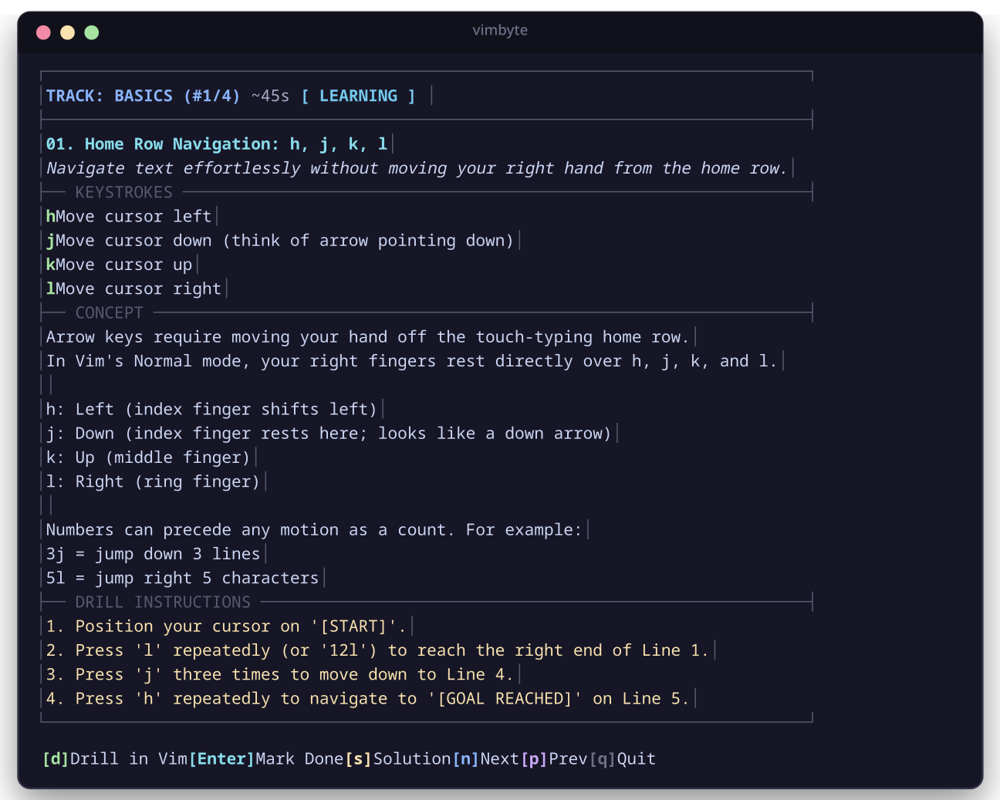

# vimbyte

A terminal tool for learning Vim through bite-sized lessons (~60s reads) and short hands-on drills (~30s practice in your real editor).

<p align="center">
  
</p>

## Install

```bash
go install github.com/RaihanStark/vimbyte@latest
```

Or build from source:

```bash
git clone https://github.com/RaihanStark/vimbyte.git
cd vimbyte
go build
```

## Quick Start

Run `vimbyte` with no arguments to open the next lesson:

```bash
vimbyte
```

Use single keys to interact:

- `d` - Open the exercise in Vim (uses `$EDITOR`, `$VISUAL`, or `vim`)
- `Enter` - Mark the lesson done
- `s` - Toggle solution and hints
- `n` / `p` - Next or previous lesson
- `q` - Quit

## Commands

```bash
vimbyte                  # Open the next lesson card
vimbyte drill [id]       # Jump straight into an editor drill
vimbyte done [id]        # Mark a lesson as completed
vimbyte review           # Review completed lessons to build mastery
vimbyte tracks           # View available tracks and progress
vimbyte switch <track>   # Switch track (basics, motions, editing, visual, registers)
vimbyte list [track]     # List all lessons in a track
vimbyte reset [track]    # Reset progress for a track (or --all)
```

## Syllabus

See [SYLLABUS.md](SYLLABUS.md) for the full 16-lesson curriculum across all 5 tracks (`basics`, `motions`, `editing`, `visual`, and `registers`).

## Flags

- `--clean`: Run Vim without plugins or configs (`vim -u NONE -c "set number nocompatible"`)
- `--editor <cmd>`: Use a specific editor (e.g. `--editor nvim`)
- `--dir <path>`: Load extra custom lessons from a folder of YAML files
- `--no-color`: Disable ANSI colors

## Progress

Progress is saved locally at `~/.config/vimbyte/state.json` (or `$XDG_CONFIG_HOME/vimbyte/state.json`).

Lessons move through four stages:
- **unseen**: Not started yet
- **learning**: Opened or drilled
- **completed**: Marked done
- **mastered**: Practiced 3 or more times

## License

MIT
